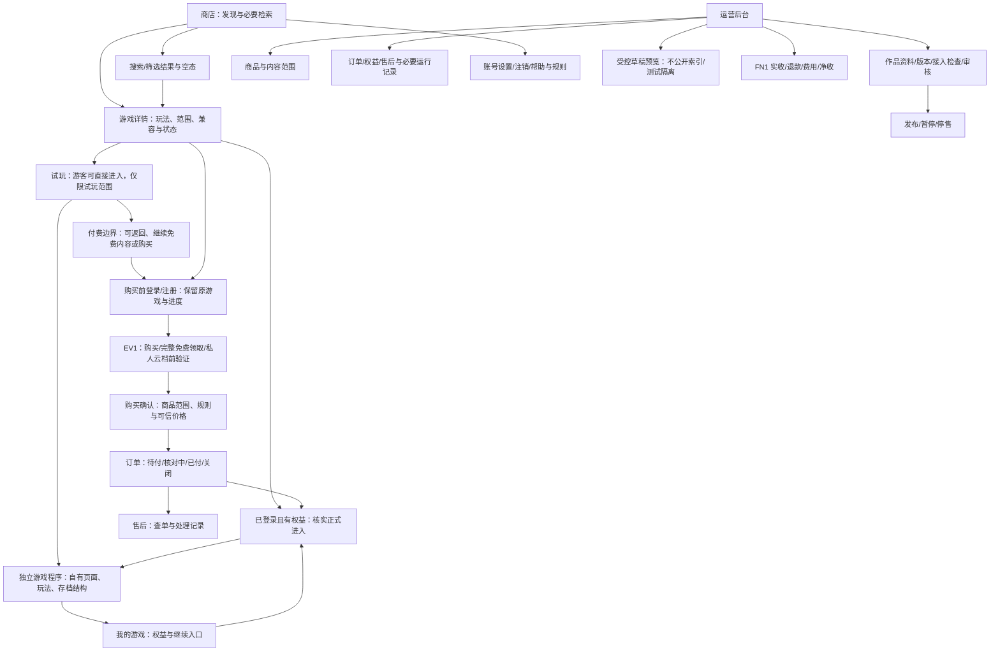

# 信息架构与产品线框

- 版本：V1.0 提交稿；日期：2026-10-24（Asia/Shanghai）。
- 状态：PR1已接受的产品结构。UI视觉与交互见已验收的UI V1.2，本文件只定义产品结构。区域表达任务、信息顺序及状态，不规定色彩、字体、卡片样式和游戏内页面模板。
- 关联：[PRD提交稿](间隙PLAY-产品需求文档-V1.0-提交稿.md)、[验收追溯](需求验收追溯矩阵-V1.0-提交稿.md)。

## 1. 页面与职责结构



图中线表达产品路径，不是 API 调用或强制弹窗。游客可直接试玩，购买前须登录；已登录玩家跳过重复识别。EV1 验证门槛、GP1 确认导入已定：验证后可选择导入兼容游客进度或跳过，有云档保留双方并选择；导入不阻塞购买。已有完整权益不重复下单；零补款升级是独立业务记录，不强行走支付订单。

## 2. 关键区域线框（产品任务顺序）

以下是未定视觉的区域顺序草图。每项均需后续 UI 验收；两类完整游戏后续由我们独立设计开发，真实独立游戏页面由游戏工程拥有。不同交互类型的介绍材料可不同，不照搬参考案例。

### WF-01 商店/搜索

```text
+--------------------------------------------------+
| 品牌/导航                        账号/我的游戏    |
+--------------------------------------------------+
| 搜索 + 筛选/清除 + 排序 + 数量/翻页               |
+--------------------------------------------------+
| 作品结果：名称/玩法摘要/设备/试玩或价格/状态       |
| 每个结果有详情入口，不强制一种游戏内展示形式     |
+--------------------------------------------------+
| 单作品真实主推；无结果有反馈；链接/返回留条件     |
| 加载/失败：保留输入 + 重试/返回                   |
+--------------------------------------------------+
```

### WF-02 游戏详情

```text
+--------------------------------------------------+
| 返回发现 / 品牌 / 账号                            |
+--------------------------------------------------+
| 作品名称 + 提供方 + 实际状态                      |
| 宣传素材与玩法说明（非游戏本身的统一页面）        |
+--------------------------------------------------+
| 设备/语言/版本/内容提示/存档支持                  |
| 试玩范围、正式内容范围、价格与追加内容说明        |
+--------------------------------------------------+
| 根据状态显示：直接试玩 / 已有权益继续 / 购买范围  |
| 无试玩、不可售、不可运行、设备不兼容分别说明      |
+--------------------------------------------------+
| 问题反馈 / 已购订单与支持入口                     |
+--------------------------------------------------+
```

### WF-03 购买与订单结果

```text
+--------------------------------------------------+
| 当前账号 + 游戏/商品 + 购买时承诺内容             |
| 币种/买断价/UP1来源/抵扣/应补/规则版本           |
+--------------------------------------------------+
| 确认购买入口 / 返回详情                          |
+--------------------------------------------------+
| 结果区：待付款 / 核对中 / 已付款 / 未付关闭       |
| 权益区：待交付 / 异常处理中 / 已可访问            |
| 查单 / 支持 / 已获权益后进入游戏                  |
+--------------------------------------------------+
```

零补款显示升级交付，不显示渠道付款成功。“已付款”和“已可进入”不是同一反馈；真实渠道界面和交互留到后续确认，不用模拟成功文案冒充到账。

### WF-04 我的游戏与重新进入

```text
+--------------------------------------------------+
| 我的游戏 / 我的订单 / 账号                        |
+--------------------------------------------------+
| 已拥有（含免费领取） / 最近游玩（试玩单列）      |
| 每作品：实际范围、版本、继续/重开确认             |
| 支持的存档状态 / 不支持说明 / 冲突或兼容反馈      |
+--------------------------------------------------+
| 作品暂停/停售时：访问事实 + 原因 + 支持            |
+--------------------------------------------------+
```

### WF-05 独立运行与平台边界

```text
+--------------------------------------------------+
| 平台提供明确的退出/返回方法（呈现方式后定）       |
+--------------------------------------------------+
| 独立游戏自有页面/导航/规则                        |
| G-A 可为故事选择；G-B 可为多个仿真页面探索        |
| 不把此区域改造成平台统一剧情模板                 |
+--------------------------------------------------+
| 游客仅试玩；触及付费再登录/购买；按权益进入       |
| 本机/云档分明；GP1确认导入/冲突选择；保留来源 |
+--------------------------------------------------+
```

是否使用内嵌外壳、独立标签、外部托管或组件留到架构。退出方法不等于平台能随意控制所有外部窗口。

### WF-06 运营作品/版本与交易查证

```text
+--------------------------------------------------+
| 有权限的管理导航 + 当前操作角色                   |
+--------------------------------------------------+
| 作品/版本：资料、能力声明、接入验证、审核状态     |
| 商品：内容范围、版本承诺、可售状态                |
| 预览：权限/不公开索引；测试/正式商品隔离          |
| 发布/暂停/停售操作：前置条件与影响说明            |
+--------------------------------------------------+
| 交易查证：订单 -> 付款 -> 权益 -> 运行版本        |
| 支持记录与审计；按权限展示必要玩家信息            |
+--------------------------------------------------+
```

### WF-07 账号、帮助与规则

```text
+--------------------------------------------------+
| 当前账号 / 邮箱验证状态 / 昵称 / 密码与退出       |
| 验证/找回：发送中、频繁、过期、已用与重试入口    |
| 注销：重新识别 -> 影响说明 -> 二次确认 -> 进度    |
| 帮助 / 支持 / 隐私 / 协议 / 购买退款规则版本日期  |
+--------------------------------------------------+
```

AD1不可逆处理前可撤回，人工核对后告知范围并最终确认；分类清理/保留按已确认DP1；不能用一个“删除成功”替代分类处理。

### WF-08 运营金额核对

```text
+--------------------------------------------------+
| 期间 / 游戏 / 币种 / 核对更新时间                 |
| 已核实实收 / 成功退款 / 已核对费用 / 净收         |
| 待核对项 / 跨期退款 / 明细与原付款来源             |
| 免费、抵扣、零补款不作为新增现金收入              |
+--------------------------------------------------+
```

净收允许为负、未知费用不当零；本区域不是财务报表视觉定稿。

## 3. 状态与响应式要求

全部关键区域需覆盖加载、空数据、失败重试、无权限、身份失效、待确认、不可用及成功反馈。不能把“未知”画成确认失败。

商店核心信息与操作在手机网页重新组织，表单标签、键盘焦点、状态信息及可触达操作在 UI 阶段验证。游戏设备兼容单独声明。未来小程序客户端复用业务概念，页面、导航与支付可用性按届时批准的端特性设计；当前不直接复制网页布局。

本文件不是可点击高保真 Demo，不满足 UI 阶段验收。

## 4. 本轮规则同步

当前 GUEST-01 游客直接试玩、付费购买前登录，替代旧 G1；PG1 同账号兼容继续不变。LG1/PK2/OP1/UP1/X1/FN1 已确认方向，补缺进入当前产品结构；GP1 游客导入、EV1 验证门槛、RF1 升级退款已确认；SS1/AD1/RS1/LC1及FS1/DP1/SV1已确认，见 [规则](账号进度与退款规则-V1.0-提交稿.md)。

当前区域 WF-01–08 是信息和任务分组，不要求拆成八条或旧稿十三条路由；最终页面清单与交互仍在产品/UI 门禁依次确认。角色、状态、能力说明不代表正式 API、SDK 或运行容器选型。

账号验证失败、导入跳过/冲突、退款现金与撤权异常需分别反馈；注销进度/撤回按已确认AD1，售后分类按已确认RS1。已确认数值与统计口径见 [规格提交稿](字段与统计规格-V1.0-提交稿.md)，未作为已批准交互或视觉方案。

首期平台简体中文、CNY金额元展示/分核对；存档展示当前与上一恢复点，冲突双方来源可辨，不增加多命名槽。账号注销申请期间限制新增资产、云档写入和新开正式运行，保留查单/售后/撤回。售后进度、分类清理状态与暂停/终止提示参照[已确认政策](产品规格与政策-V1.0-提交稿.md)，不提前定稿UI。

## 5. 固定交接边界

本文件与PRD第2.9节的综合分版一起提交验收，整包尚未接受。WF-01–08是产品区域，不强制八个路由、单一布局或统一游戏页面。默认最新发布、每页12、详情素材/字段上限按FS1；字号/色彩/组件及设备规格留UI确认。

WF-03必须分别显示报价到期/变化、原权益来源、支付未知、零补款升级、退款与撤权处理；WF-04/05必须区分当前档/上一恢复点/冲突双方及未接收第三来源，超限不假报云保存；WF-07按AD1人工核对与最终确认、即时停访问、分类清理结果和可查询支持路径呈现；WF-06/08按SV1售后目标、暂停恢复/终止通知及可信金额事实呈现。

如获准UI首节点，先检查原HTML中的Logo和相关资产，再提交视觉方向与有限关键商店/后台页面比较；确认后才扩展全套设计与可交互Demo。当前没有视觉稿、高保真实现或正式架构。
