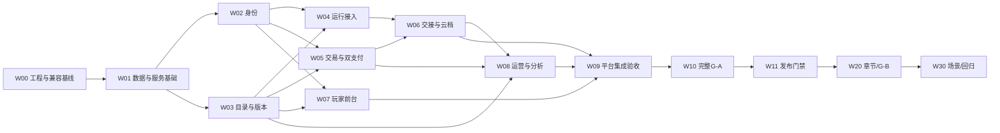

# 实施计划与里程碑

状态：阶段4计划已按P41接受；2026-10-28，Asia/Shanghai。角色：技术经理。依据为当前会话实际选择AC1／GP1／EP1／CM1及[当前有效决策](../../03-架构/01-决策/当前有效决策.md)。本次只编制计划，不实施业务、连接服务、执行SQL、采购或部署。

## 1. 目标、范围与事实

把已接受的产品、UI和架构分解为可独立评审、实现、测试和验收的工作包。平台负责商店、账号、交易权益、运行接入、约定存档、事件及运营；游戏自有内容、页面、玩法、数据与技术框架。平台不提供强制剧情引擎。

| 对象 | 已确认事实 | 实施前仍需核实 |
| --- | --- | --- |
| 产品和UI | PR1产品V1.0、UA1设计V1.2；V0.1买断/G-A，V0.2章节/G-B/升级，V0.3场景与回归 | Demo全模拟，不能用视觉验收替代业务验收 |
| 架构 | AC1有边界设计验收；Java模块化底座、既有Vue管理端、独立来源游戏、薄SDK、Nuxt静态方向 | 精确制品、真实运行、外部资源和费用尚未定版 |
| 数据 | 当前目标xj_play，平台xj_、各游戏xjg_<gameKey>_、底座前缀保留，filemeta例外；0物理外键 | 49平台表之外的底座裁剪和游戏表需分别核定；不直接执行上游DROP脚本 |
| 参数 | GP1：30分钟登录资格、15分钟交接、24小时位置；EP1：72小时窗口、5分钟容差 | 服务端计时，ER-A结束后拒绝；运行边界、并发和过期均待测试 |
| 复用基础 | Java隔离编译历史通过；管理端隔离构建通过但11处TS2304；Nuxt仅静态夹具 | 原工程未适配，不承诺安装即可运行 |
| 支付和恢复 | 首期外部浏览器双支付；CR1目标RPO15分钟/RTO4小时 | 商户资格未知、binlog关闭、对象与恢复未演练；不是生产就绪 |

本文不变更[PRD](../../02-产品与设计/01-产品规划/01-文档/间隙PLAY-产品需求文档-V1.0-提交稿.md)、[设计系统](../../02-产品与设计/02-界面设计/03-文档/设计系统与交付规范-V1.2.md)或[技术选型](../../03-架构/03-文档/技术选型与定版条件.md)。移动客户端、小程序、Steam、自助创作者入驻及结束后跨会话事件补报，不因本计划新增授权。

编号消歧：产品规则中的“GP1进度导入”与2026-10-28确认选项“GP1交接时限”来自不同轮次，分别有效。购买意图位置、游客存档导入和正式权益是三个对象，不以其中一个替代另两个。

## 2. 推荐推进方式与备选

推荐按“前置风险核实→可信业务基础→最小接入与平台闭环→完整独立游戏→公开发布”顺序推进。每个切片先提交Trellis规划与验收条件，批准后实施，完成后附证据交用户验收。当前仅请求接受计划并允许细化首个切片，不请求一次性开放全部开发。

| 路径 | 收益 | 代价与适用条件 |
| --- | --- | --- |
| 推荐：先M0工程与兼容基线，再分片开发 | 尽早发现驱动、类型错误、许可和隔离资源阻塞；复用已有工程 | 首个交付以证据和工程健康为主，完整商业流程较后出现 |
| 前后台页面优先 | 页面较快可浏览 | 核心信任链可能长期只有模拟；需要用户重新批准实施顺序，不能代替支付和接入验收 |
| 等全部生产资源齐备再启动 | 减少外部条件返工 | 等待周期未知；本地实现和隔离验证也被拖后，不推荐作为全局前置 |

## 3. 工作分解与里程碑

工作包、依赖和人日区间唯一数据源为[工作包清单](../02-图表/工作包清单.json)，[相对工作量甘特图](../02-图表/实施依赖与相对甘特.html)由该清单生成当前离线快照。这里列交付责任和退出门槛；全部工作包均为待授权、未开始。

| 工作包／里程碑 | 主要交付与边界 | 前置与退出条件 | 责任角色 |
| --- | --- | --- | --- |
| W00／M0 工程与兼容基线 | 核正式工程构建入口、11处类型错误成因、GB1分发边界、精确依赖与许可、MC1验证计划和资源缺口 | 先批准切片规划；退出需构建与类型检查证据、未通过项及处理建议；无资源时不得宣称实连通过 | 技术负责人、前后端、测试 |
| W01／M1 数据与服务基础 | 底座保留表清单、应用身份、迁移与回退、事务守卫、outbox/租约和审计 | W00；批准具体身份、数据范围及SQL执行环境后才建表；0外键、拒绝破坏性上游种子 | 后端、数据、运维、测试 |
| W02／M2 身份与账号 | 游客/玩家/管理员边界、注册登录、邮箱验证、会话撤销、设置与注销 | W01；账号隔离、CSRF、限流、重试与注销不复活用例通过 | 后端、前端、测试 |
| W03／M3 目录与版本发布 | 发现/筛选/详情数据、商品与contentKey、草稿/预览/发布/暂停、静态快照 | W01；公开/私有包及草稿隔离，发布失败与回退可核对 | 前后端、运营、测试 |
| W04／M4 独立游戏运行 | 宿主、薄SDK、Manifest、消息桥、受控资源、run生命周期；最小协议样例；宿主与游戏协同静音/避免突发声 | W02+W03及独立来源/对象资源；来源伪造、握手失效、资源越权均拒绝；加载阶段真实，扩大/返回可用，商店不预载完整游戏包；样例不是完整游戏 | 前后端、游戏接入、安全测试 |
| W05／M5 买断交易与双支付 | 可信报价/订单、支付宝/微信适配、核实/对账、权益与退款、非现金授予 | W02+W03；双渠道分别具备资格与测试条件；回跳不授予权益，未知结果先查证 | 后端、前端、财务运营、测试 |
| W06／M6 位置交接与云档 | GI-A/RT1及交接时限、产品GP1游客进度导入、账号游戏库/继续摘要、CAS/冲突/恢复确认 | W04+W05；30/15分钟/24小时边界、换号/争抢/响应丢失、位置与权益分离；导入可跳过而继续购买，保留来源与原云档，并发变化后重新确认 | 前后端、游戏接入、测试 |
| W07／M7 玩家前台 | 按UA1实现商店、账号、订单、游戏库、宿主及状态页；静音/扩大/返回与真实加载阶段 | W02+W03提供稳定接口；最终验收依赖W04/W05/W06，商店与游戏包加载分离，不以占位请求层宣称联调通过 | 前端、UI复核、测试 |
| W08／M8 管理运营与分析 | 已确认后台页面/RBAC、现金与费用分列、31事件、EP1/ER-A、清理与支持 | W03+W05+W06；可信SERVER事实与低信任观察分离，任务重试/租约/分析缺口可核对 | 全栈、运营、测试 |
| W09／M9 平台集成验收 | 真实接入样例、端到端/权限/并发/故障/容量测试、私有对象与恢复演练 | W07+W08；阻塞缺陷清零，未通过目标明确升级决策，不静默放宽CR1 | 测试负责人、安全、运维 |
| W10／M10 完整G-A | 平台基础之后独立设计、制作、测试并接入故事主线互动剧本游戏 | W09；内容、规模、试玩边界和结局另行确认；完整可玩与平台协议分别验收 | 游戏产品、内容、游戏工程、测试 |
| W11／M11 V0.1发布 | 完整G-A与真实平台买断/双支付/存档/运营，部署和运维交付 | W10及生产资源、测试、发布验收、真实操作授权；生产恢复演练可验证 | 发布负责人、运维、用户验收 |
| W20／M20 V0.2 | 章节商品/净实付抵扣升级、完整G-B线索链接仿真网页探索游戏及接入 | W11；UP1/RF1并发与章节映射；G-B内容另审，小游戏案例不是照搬授权 | 平台与独立游戏角色 |
| W30／M30 V0.3 | 场景商品、升级与双游戏跨版回归 | W20；场景标识由游戏定义，跳链接/重进不计次收费 | 平台、游戏、测试 |

W04的测试样例仅验证协议和信任链；W10/W20完整游戏分别承担内容交付。完整游戏不是平台统一页面模板，也不能拿样例替代AC-10/13。

## 4. 依赖、迭代和估算口径

甘特图表示单执行者按依赖拓扑串行的估计工作量，时间原点T0不是实际开工日。1人日按8小时专注工作估算，含开发、必要测试和评审，不含采购/商户审核/用户等待。当前已估平台工作包合计73–129人日；未知游戏及后续版本不计入，不能据此得出完整项目工期。人日总和不等于自然日，不将多个智能体角色视为真实并行团队。

已给区间的仅是平台工作包；完整G-A/G-B内容未定，W10/W20/W30不填虚构工期。每个切片规划时按接口、异常与测试再拆估算，出现兼容失败或范围变化更新原表。预算包含工程、人力、计算、数据库维护、对象/备份/见证、流量、域名、邮件、监控和支付费率；单价与数量未取证，当前不填总价。

推荐迭代按里程碑验收，不规定固定周数。多人并行必须先明确真实产能与接口责任；若只有一个执行者，按依赖排序串行，以较大工作量区间评估风险。外部资格缺失可继续已获准且不依赖该资格的工作，不能跳过最终真实支付或恢复验收。

## 5. 角色、分支、评审与变更

角色是职责，不代表已有团队。用户负责范围、成本、阶段及发布决定；技术负责人对跨模块契约与集成负责；前后端/游戏角色各自维护独立工程；测试角色独立核证；运维角色承担环境、权限、备份与回退。一个人可兼任多个角色，但不能把自查写成独立复核。

根仓库当前main是本轮确认基线。后续每个获批实现切片创建`codex/<切片名>`分支，提交前核根仓库与可能存在的嵌套仓库边界；不擅自重置、合并或推送。采用`feat/fix/docs/test/chore`描述提交目的，范围精准暂存；本地忽略目录与受保护配置不进提交。

代码遵守`.trellis/spec/`对应层约定、现有工程风格与类型检查；API/Schema/模型从源生成并检查漂移。评审同时核需求与实现、越权/幂等/异常、许可和可维护性；按[测试与验收](测试验收与追溯.md)保存真实证据。契约变更先说明兼容/数据/成本/验收影响，由用户决定，更新当前对象与集中决策，不增建平行旧版。

回退以最后已验收制品和显式数据兼容策略为依据；删列、撤销事实、订单或对象版本不能靠前端回滚修复。发布失败时先关闭有风险入口并保留事实，按批准恢复方案处理，不在当前执行演练。

## 6. 当前任务看板与下一门禁

| 状态 | 对象 |
| --- | --- |
| 已完成 | AC1阶段3有边界设计验收；GP1/EP1参数确认；本阶段计划编制与文档自查 |
| 待用户审阅 | 本计划、工作包清单/甘特、测试追溯、资源风险及首切片建议 |
| 已允许规划 | P41允许细化W00具体文件、动作、测试、回退供审；实施未获授权 |
| 待开发授权 | W00及全部后续实现工作包；各包必须有明确规划与验收边界 |
| 资源待满足 | 服务实连、同库测试数据隔离、对象/备份、双支付、域名邮件与生产资源 |

2026-10-28实际P41接受本计划，允许细化W00规划供审；仍不启动实施。CM2允许本轮计划限定路径本地提交、不推送，详见[本次确认记录](../03-评审/本次确认记录.md)。高保真新改动另按[影响核对](../03-评审/高保真更新影响核对.md)处理，不自动修改既有产品/UI/接口。
